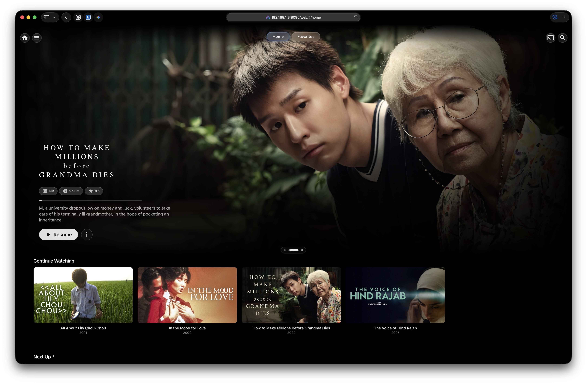
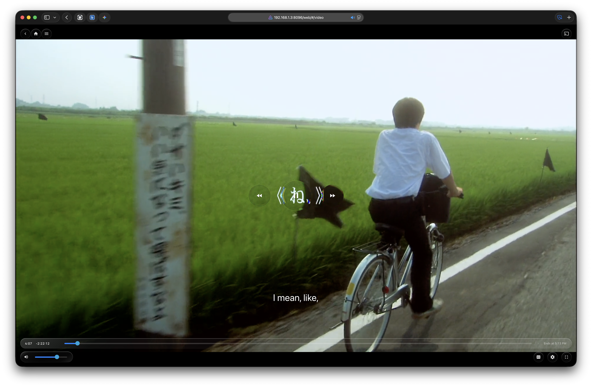

# Jellyfin Liquid Glass

I keep three full-app themes for [Jellyfin](https://jellyfin.org) in this repo. Paste **one** CSS file into Custom CSS. Do not paste more than one file.

| Theme | CSS file | Lens script | Sentinel |
|-------|----------|-------------|----------|
| **Liquid** (default) | [`style.css`](./style.css) | `tools/osd-lens-glass.js` | `--liquid-glass-theme: on` |
| **Cyberpunk liquid** | [`style-cyberpunk-liquid.css`](./style-cyberpunk-liquid.css) | `tools/osd-lens-cyberpunk.js` | `--cyberpunk-liquid-theme: on` |
| **Cyberpunk** | [`style-cyberpunk.css`](./style-cyberpunk.css) | none | `--cyberpunk-theme: on` |

In Liquid I use translucent surfaces, live refraction, and Apple system blue (`#0a84ff`). I use that look on the home screen, in libraries, on detail pages, in settings, in menus, and in the video player.

In Cyberpunk liquid I keep the floating OSD and the glass from Liquid. The stage is void (`#090c12` / `#10131a`). The accent is neon lime (`#b8ff2e`), with sparse cyan and magenta. I set the text in Switzer and JetBrains Mono.

On a fine-pointer desktop, I use a spectral WebGL lens on the Cyberpunk liquid transport. The rim uses lime, cyan, and magenta, plus fresnel. A phone or a tablet does not run that WebGL lens.

I match Cyberpunk to the dark index on [jyothin.com](https://jyothin.com). The stage is void black (`#000` / `#090c12`). I set the type in Switzer. I set labels in JetBrains Mono, in tracked uppercase. I color rules and progress with the idle-spectrum peach (`#f7b685`). I do not add glass frost, SVG displacement, or a WebGL lens.

I use the home spotlight from **[Abyss](https://github.com/AumGupta/abyss-jellyfin)** beside this theme. I wrote the rest of the UI in this repo’s CSS. Liquid and Cyberpunk liquid also load a WebGL lens on the transport. Cyberpunk does not load a lens.

<p align="center">
  
</p>

<p align="center"><em>Home. The Abyss Spotlight banner is above my Liquid Glass chrome.</em></p>

---

## Screenshots

### Home

The Abyss Spotlight hero shows Continue Watching and Next Up. Under that hero I use header pills and rows from Liquid Glass.


### Player

I center the transport. My WebGL lenses refract the rims. I place volume at the bottom left. I lift the scrubber. I place CC, settings, and fullscreen at the bottom right.



---

## Inspirations & credits

| Source | What I took | What I did not |
|--------|----------------|-----------------|
| **[Abyss](https://github.com/AumGupta/abyss-jellyfin)** by AumGupta | I use the Home Spotlight banner. It shows the backdrop, the logo or title, and pills for rating, runtime, and score. It also shows resume and a carousel. I override the Abyss player rings on `#videoOsdPage`. Those rings are the prism and the center-cluster halos. I do that so the Liquid Glass transport can replace them. | I do not include the full Abyss `abyss.css` as this theme. Spotlight is a separate install. Put `spotlight.html` and the inject scripts in Jellyfin `web/ui`. |
| **Apple Liquid Glass / Vision Pro / Apple TV** | I use translucent floating controls and near-clear glass. I use SF-first typography, Apple system blue (`#0a84ff`), poster cards, and sidebar selection. I also use iOS-style sliders. | This is not an official Apple skin. I include no proprietary assets. |
| **[kube.io liquid glass (Maxime Bourgeois)](https://kube.io/blog/liquid-glass-css-svg/)** | I use a physics-based SVG `feDisplacementMap` for the CSS glass. The profile is a squircle. The refraction follows Snell–Descartes. I bake the displacement map in `tools/generate-liquid-glass.py`. | I bake the map offline. I do not run the kube.io playground in this theme. |
| **[ybouane LiquidGlass](https://liquid-glass.ybouane.com)** | I use the player transport look from that demo. I keep the disc center clear. The rim bends the picture. The rim adds chromatic aberration. | I wrote that look in my own shader, `tools/osd-lens-glass.js`. I do not embed the ybouane library. |

### How Abyss Spotlight fits

1. Abyss spotlight scripts inject an iframe (`web/ui/spotlight.html`) on the home view.
2. The iframe reads Continue Watching and Next Up. If those rows are empty, it uses library items. It paints the hero.
3. I style the header, the drawer, the rows, and the cards around the hero. I use the `--osd-pill-*` tokens and the global glass tokens. The page keeps one visual system.
4. On the player, I override the decorative Abyss rings so they do not compete with the WebGL lenses.

If you want only the Liquid Glass CSS, do not install Abyss Spotlight. Home then uses Jellyfin’s normal sections.

---

## Features

- **One design language per theme.** I give each theme one glass recipe and one accent. I apply that recipe to the header, the drawer, dialogs, and action sheets. I also apply it to settings, forms, cards, and the player.
- **Abyss Spotlight home** (optional companion). You can add the Abyss Spotlight banner for resume.
- **Live player glass.** On a desktop I use CSS displacement on the pills. I use WebGL lenses on rewind, play-pause, and forward. In Liquid I use a clear rim with chroma. In Cyberpunk liquid I use a spectral rim on desktop only.
- **Low FX on phone and tablet.** Low FX matches `(pointer: coarse)`, `max-width: 60em`, or `prefers-reduced-motion: reduce`. My CSS then sets `--fx-disp` empty. The empty value stops SVG displacement. The lens does not start WebGL.

  The CSS frost discs remain. I cap the blur. I stop the grain and scan overlays.
- **Graceful degrade.** Disable Custom CSS in the client. Stock buttons and menus then show. Each lens runs only when its sentinel is present. The Liquid sentinel is `--liquid-glass-theme: on`. The Cyberpunk liquid sentinel is `--cyberpunk-liquid-theme: on`. The file `style-cyberpunk-liquid.css` does not set `--liquid-glass-theme`.
- **Responsive.** I set breakpoints for desktop, tablet, and mobile. The breakpoints cover the OSD and the library UI. I keep the transport fixed at the center. I place Cast with `right: var(--osd-right-edge)`.

---

## Installation

Paste one theme. Install the lens that matches that CSS. My installer injects one lens script. It does not inject both. `THEME=cyberpunk` injects no lens.

### 1. Theme CSS (required)

Open **Dashboard → General → Custom CSS** for a server-wide theme. Or paste the CSS into `<CustomCss>` in `branding.xml`.

| Theme | Paste this file |
|-------|-----------------|
| Liquid | all of [`style.css`](./style.css) |
| Cyberpunk liquid | all of [`style-cyberpunk-liquid.css`](./style-cyberpunk-liquid.css) |
| Cyberpunk | all of [`style-cyberpunk.css`](./style-cyberpunk.css) |

Save the CSS. Then refresh the page with `Ctrl+Shift+R`. After you change the branding, Jellyfin often needs a container restart.

### 2. WebGL transport lens (recommended)

Custom CSS is text inside a `<style>` tag. That text cannot load a script. Install the matching lens as a real file.

Liquid is the default. The command writes `style.css`. It copies `osd-lens-glass.js`. It links `?v=refraction-<hash>`:

```bash
./tools/install-into-docker.sh
# same as: THEME=liquid ./tools/install-into-docker.sh
```

The command writes `style-cyberpunk-liquid.css`. It copies `osd-lens-cyberpunk.js`. It links `?v=spectral-<hash>`:

```bash
THEME=cyberpunk-liquid ./tools/install-into-docker.sh
```

`THEME` accepts `liquid`, `cyberpunk-liquid`, or `cyberpunk`. The script removes the other lens tag from `index.html`. `THEME=cyberpunk` removes both lens tags. It does not add a lens tag.

The script also installs a persist hook in `custom-cont-init.d`. The hook reads `/config/liquid-glass/theme.txt`. After an image update, the hook links only the matching lens when the theme has one. For `cyberpunk`, the hook removes the lens tags. It does not add a lens tag.

Cyberpunk installs no lens:

```bash
THEME=cyberpunk ./tools/install-into-docker.sh
```

**Manual (liquid):** Copy `osd-lens-glass.js` into Jellyfin web `ui/`. Add the line below before `</body>`:

```html
<script src="ui/osd-lens-glass.js?v=refraction-1" defer></script>
```

**Manual (cyberpunk liquid):** Copy `osd-lens-cyberpunk.js` instead. Do not add both script tags.

```html
<script src="ui/osd-lens-cyberpunk.js?v=spectral-1" defer></script>
```

### 3. Abyss Spotlight (optional, for the home hero)

Follow [Abyss setup](https://github.com/AumGupta/abyss-jellyfin/blob/main/SETUP.md) for the spotlight scripts. Those files are `spotlight.html`, `spotlight.css`, the inject script, and the home chunk patch. Or use the Abyss installer. Keep the Jellyfin display theme on **Dark**.

I assume Spotlight is already on the server, as in the screenshots. I wrote the Liquid Glass CSS to work beside Spotlight.

---

## Requirements

- Jellyfin **10.9+** (web client)
- Browser with **`backdrop-filter`** (Chrome, Edge, Safari, Firefox 103+)
- WebGL for the transport lenses. If a texture upload fails, the lens uses CSS frost.

---

## Customization

Liquid tokens are at the top of `style.css`:

```css
:root {
  --liquid-glass-theme: on;   /* sentinel for osd-lens-glass.js — do not remove if you use that lens */
  --accent-blue: #0a84ff;
  --blur: blur(22px) saturate(170%) brightness(102%);
  /* Player */
  --osd-transport-size: 5.6em;
  --osd-transport-large: 7.6em;
}
```

Cyberpunk liquid tokens are at the top of `style-cyberpunk-liquid.css`. Keep `--cyberpunk-liquid-theme: on`. Do not add `--liquid-glass-theme` to that file.

```css
:root {
  --cyberpunk-liquid-theme: on; /* sentinel for osd-lens-cyberpunk.js */
  --sys-lime: #b8ff2e;
}
```

The liquid lens look is in `tools/osd-lens-glass.js`. After an edit, run the install script with `THEME=liquid`:

| Constant | Role |
|----------|------|
| `REFRACTION` | Rim bend strength |
| `CHROMA` | RGB split amount |
| `CHROMA_SAT` | How much fringe replaces the base |
| `CHROMA_GREEN_SAT` | Green-only desaturation in the fringe (`1` = full green) |

The cyberpunk liquid lens is in `tools/osd-lens-cyberpunk.js`. After an edit, run the script with `THEME=cyberpunk-liquid`. The console prefix is `[osd-lens-cyberpunk]`.

Cyberpunk tokens are at the top of `style-cyberpunk.css`. Keep `--cyberpunk-theme: on`. Do not add `--liquid-glass-theme` to that file. Do not add `--cyberpunk-liquid-theme` to that file. This theme has no lens script.

```css
:root {
  --cyberpunk-theme: on;
  --cp-stage: #090c12;
  --cp-ink: #f3f0ff;
  --cp-accent: #f7b685;
}
```

---

## Client opt-out

| Goal | How |
|------|-----|
| Stock Jellyfin UI | Settings → Display → **Disable server-provided custom CSS** |
| Keep liquid CSS, skip WebGL | Console: `liquidGlassLens.disable()` / `.enable()`, or `localStorage.jellyfin-liquid-glass-lens = 'off'`, or `?nolens=1` |
| Keep cyberpunk liquid CSS, skip WebGL | Console: `cyberpunkLiquidLens.disable()` / `.enable()`, or `localStorage.jellyfin-cyberpunk-liquid-lens = 'off'`, or `?nolens=1` |
| Cyberpunk (no WebGL) | The theme has no lens. Disable Custom CSS to return to stock Jellyfin. |

On a phone or a tablet, the lens script exits before it creates a WebGL context. You do not need the opt-out key for that path.

---

## Repo layout

| Path | Role |
|------|------|
| `style.css` | Liquid theme + OSD layout |
| `style-cyberpunk-liquid.css` | Cyberpunk liquid theme + same OSD layout |
| `style-cyberpunk.css` | Pure cyberpunk theme (jyothin.com index). No lens |
| `tools/osd-lens-glass.js` | WebGL lens for the Liquid transport |
| `tools/osd-lens-cyberpunk.js` | WebGL lens for Cyberpunk liquid. Desktop only |
| `tools/install-into-docker.sh` | `THEME=liquid`, `THEME=cyberpunk-liquid`, or `THEME=cyberpunk` |
| `tools/99-liquid-glass-lens.sh` | Cont-init persist hook (one lens, or none for `cyberpunk`) |
| `tools/generate-liquid-glass.py` | Bake CSS displacement map (kube.io math) |
| `tools/capture-readme-shots.py` | Gallery shots from headless Chromium |
| `info.md` | OSD hard rules and history |
| `docs/screenshots/` | README images |

---

## Capturing updated screenshots

Run these commands when Jellyfin is running. Chromium must be available.

```bash
chromium --headless=new --remote-debugging-port=9333 \
  --user-data-dir=/tmp/jf-shot --no-sandbox \
  --autoplay-policy=no-user-gesture-required about:blank &

export JF_TOKEN='…' JF_USER='…' JF_SERVER='…' JF_URL='http://localhost:8096'
python3 tools/capture-readme-shots.py
```

---

## License

The license is MIT. You may use this project. You may change it.

**Third-party:** Abyss Spotlight keeps its own license and its own project. The kube.io article and the ybouane demo are inspiration only.
